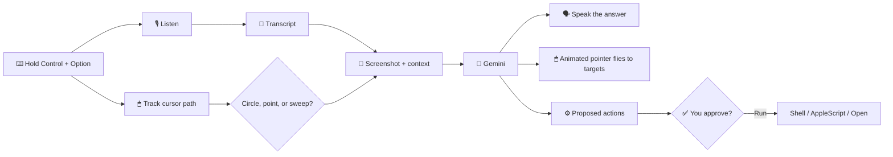

<div align="center">


# 🫶 HeyBuddy

### An AI buddy that lives next to your cursor.
**Hold a key. Talk. Point or circle. It sees your screen, flies to what matters, explains it out loud, and can even do the task for you.**


[✨ Features](#-features) · [🚀 Quick Start](#-quick-start) · [🎮 Try It](#-try-it-click-to-expand) · [🧠 How It Works](#-how-it-works) · [🛠 Troubleshooting](#-troubleshooting) · [🗺 Roadmap](#-roadmap)

</div>

---

## ✨ Features

| | Feature | What it means |
|---|---|---|
| 🎙 | **Hold-to-talk** | Hold **Control + Option**, speak, release. Nothing runs in the background. |
| 👀 | **Sees your screen** | Every request includes a screenshot so answers match what you're looking at. |
| ⭕ | **Circle & point** | Circle files, icons, or text and say "this". HeyBuddy knows what you mean. |
| 🖱 | **Animated cursor** | A glowing pointer trails your real one, flies to targets, rings them, and labels each step. |
| 🗣 | **Talks back** | Explains out loud while it points, step by step. |
| 🤖 | **Does tasks** | "Make a folder and move these files in." It plans the steps and runs them after you approve. |
| 💬 | **Follow-ups** | Remembers the last few exchanges, so "and how do I undo that?" just works. |
| 🆓 | **Free to run** | Bring your own free Gemini API key. No server, no subscription. |

---

## 🎮 Try it (click to expand)

<details>
<summary><b>👆 "How do I do this?" (learn mode)</b></summary>

<br>

1. Hold **Control + Option**.
2. Say: *"Hey Buddy, how do I open a new tab?"*
3. Release.

HeyBuddy flies the cursor to the right button, rings it, and explains in plain words. Ask a follow-up right after: *"and how do I close it?"*

</details>

<details>
<summary><b>⭕ "What is this?" (circle mode)</b></summary>

<br>

1. Hold **Control + Option**.
2. Draw a circle around anything on screen while saying: *"Hey Buddy, what is this?"*
3. Release.

The loop you draw is detected and sent with your question, along with the name of the UI element under your cursor.

</details>

<details>
<summary><b>📁 "Do it for me" (task mode)</b></summary>

<br>

1. Select some files in Finder.
2. Hold **Control + Option** and say: *"Hey Buddy, make a folder called Taxes on my Desktop and move these in."*
3. Release and review the plan in the confirmation dialog.
4. Click **Run**.

Nothing runs without your approval, and the dialog shows exactly what will happen first.

</details>

<details>
<summary><b>🔁 Follow-ups</b></summary>

<br>

Just keep going: *"Make it bigger", "Now rename it", "Why did that work?"* The last six exchanges are remembered.

</details>

---

## 🚀 Quick Start

### 1. Requirements
- A Mac running **macOS 13 or newer**
- **Xcode** (free from the App Store)
- A **free Gemini API key** from [aistudio.google.com/apikey](https://aistudio.google.com/apikey)

### 2. Run it in Xcode
```bash
git clone https://github.com/YOUR-USERNAME/HeyBuddy.git
cd HeyBuddy
open Package.swift     # opens the project in Xcode
```
Then press **⌘R**.

### 3. Or build it from the terminal
```bash
chmod +x build.sh
./build.sh
```

### 4. Onboarding
On first launch a dialog asks for:
1. **A name** for your buddy (e.g. *Nova*). You can then say "Hey Nova…".
2. **Your Gemini API key.**

A **◎** icon appears in your menu bar. Click it for **Settings** or **Quit**.

### 5. Grant permissions
Open **System Settings → Privacy & Security** and allow:

| Permission | Why |
|---|---|
| 🎤 Microphone | Hear your voice |
| 🗣 Speech Recognition | Turn speech into text |
| 🖥 Screen & System Audio Recording | See your screen |
| ⌨️ Input Monitoring | Detect the Control + Option hotkey |
| ♿ Accessibility | Know which UI element is under your cursor |
| 🤖 Automation (Finder) | Run file tasks for you |

> 💡 **Running from Xcode?** macOS may attribute permissions to **Xcode** instead of HeyBuddy. Enable both.

---

## 🧠 How It Works



### Project layout
```text
HeyBuddy/
├── Package.swift
├── build.sh
└── Sources/Buddy/
    ├── main.swift          # app entry point
    ├── AppDelegate.swift   # hotkey, onboarding, gestures, action runner
    ├── Ears.swift          # microphone + speech recognition
    ├── Screen.swift        # screenshot + Accessibility lookup
    ├── Overlay.swift       # the animated cursor, rings, and labels
    └── Brain.swift         # Gemini calls, retries, model fallback
```

### Models
HeyBuddy tries models in order and retries automatically if one is busy:

```swift
let models = ["gemini-3.8-flash", "gemini-3.5-flash", "gemini-3.1-flash-lite"]
```
Model names change over time. If one is retired, edit this list in `Brain.swift`.

---

## 🛠 Troubleshooting

<details>
<summary><b>Error 500 / "high demand"</b></summary>

<br>

That's Google's server being busy. HeyBuddy retries and falls back to other models automatically. If all fail, wait a minute and try again.

</details>

<details>
<summary><b>"I can't capture the screen"</b></summary>

<br>

Turn on **Screen & System Audio Recording** for HeyBuddy (and Xcode if you run from it), then fully restart the app.

</details>

<details>
<summary><b>Nothing happens when I hold Control + Option</b></summary>

<br>

Enable **Input Monitoring** and **Accessibility**, then quit and relaunch. Both only take effect after a restart.

</details>

<details>
<summary><b>It doesn't hear me</b></summary>

<br>

Check the Microphone and Speech Recognition permissions. In Xcode, look for `Heard:` in the console to see what it transcribed.

</details>

<details>
<summary><b>The pointer lands in the wrong place</b></summary>

<br>

Coordinates come from the model on a 0–1000 grid. Only the main display is supported for now. Try again with fewer overlapping windows, and please open an issue with a screenshot.

</details>

---

## 🔒 Privacy & Safety

- Screenshots and your transcript are sent to **Google's Gemini API** for each request. Don't use it with sensitive content on screen.
- Your API key is stored locally on your Mac.
- **Every action needs your approval** before it runs, and the dialog shows the exact command.
- Audio is only recorded while you hold the keys.

---

## 🗺 Roadmap

- [x] Hold-to-talk hotkey
- [x] Voice in, voice out
- [x] Circle / point / sweep detection
- [x] Animated pointer with rings and labels
- [x] Task automation with confirmation
- [x] Model fallback and retries
- [ ] Think → act → check loop (multi-step agent)
- [ ] Streaming responses for faster replies
- [ ] Pointer synced to speech
- [ ] Multi-monitor support
- [ ] Keychain storage for the API key
- [ ] Undo for file actions
- [ ] Better voices
- [ ] Custom wake phrase

---

## 🤝 Contributing

Ideas, bug reports, and pull requests are welcome.

1. Fork the repo
2. Create a branch: `git checkout -b feature/my-idea`
3. Commit and push
4. Open a pull request

---

## 📄 License

MIT. See `LICENSE`.

<div align="center">

**Made with 💙 by [YOUR NAME](https://github.com/YOUR-USERNAME)**

⭐ If HeyBuddy helped you, star the repo!

</div>
